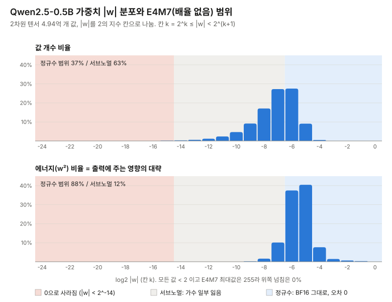
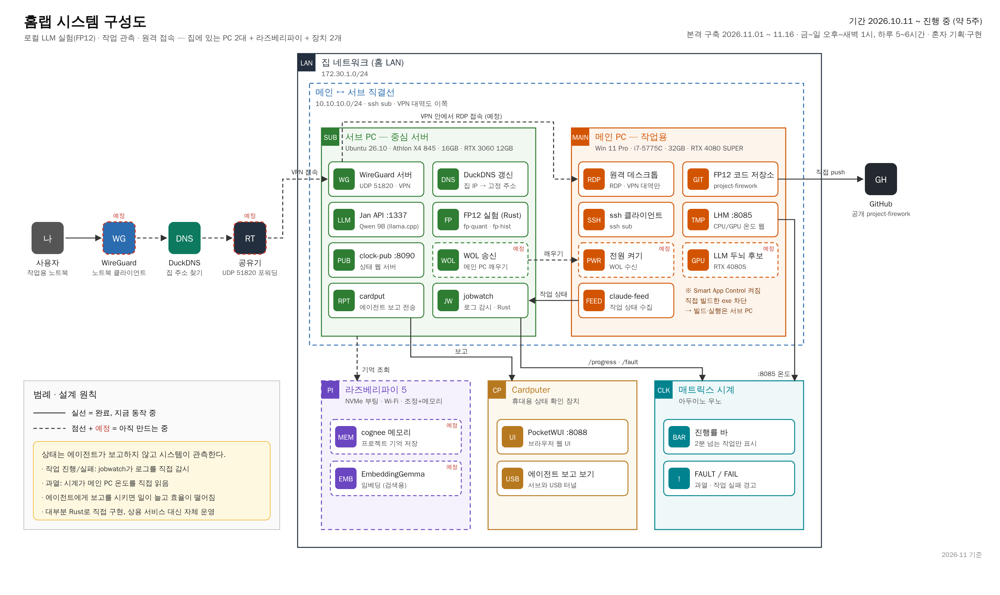

# project-firework

[English](README.md) | **한국어**

Tiny tweaks that light up llm.

**LLM 가중치를 더 작은 소수(float) 형식으로 담아도 괜찮은지** 실험하는 프로젝트예요. 첫 목표는 **FP12**, 즉 12비트 float이에요. BF16(16비트)과 거의 같은 품질을 유지하면서 메모리는 25% 줄이는 게 목표예요. 코드는 전부 Rust로 썼어요.

## 12비트 float은 어떻게 생겼나

float은 세 부분으로 나뉘어요. **부호**, **지수**(얼마나 크거나 작은 수까지 담을지), **가수**(얼마나 정밀하게 담을지).
12비트를 어떻게 나눌지 고를 수 있어요. 예를 들면:

| 형식 | 부호 | 지수 | 가수 | 설명 |
|---|---|---|---|---|
| BF16 (원본) | 1 | 8 | 7 | 모델이 원래 저장된 형식 |
| **E4M7** | 1 | 4 | 7 | 정밀도는 BF16과 같고 범위만 좁음 |
| E5M6 | 1 | 5 | 6 | 범위는 넓고 정밀도 1비트 손해 |
| E6M5 | 1 | 6 | 5 | 범위는 더 넓고 정밀도는 더 손해 |

## 작업 흐름

실험은 매번 같은 순서로 해요. 실험은 서브 PC에서 돌려요 ([홈랩](#홈랩) 참고).

1. **변환**: `fp-quant`가 모델 가중치(`.safetensors`)를 읽어서 모든 값을 고른 형식(예: E4M7)으로 반올림해요. 파일은 BF16 그대로라서 결과를 llama.cpp에 바로 넣을 수 있어요.
2. **품질 측정**: `scripts/ppl.sh`가 각 파일을 GGUF로 바꾸고 wikitext-2로 `llama-perplexity`를 돌려요. perplexity(PPL)는 낮을수록 좋아요. 원본 모델과 비교해요.
3. **이유 찾기**: `fp-hist`가 가중치 값이 어느 지수 구간에 몰려 있는지, 몇 개가 아주 작은 "서브노멀" 구간으로 밀리거나 사라지는지 세요.
4. **정리**: 결과와 그래프를 리포트로 남겨요 (아래).

오래 걸리는 작업은 `~/jobs/`에 로그를 남겨요. 감시 프로그램이 로그를 읽어서 책상 위 시계에 진행률을 띄워 줘서, 사람이 직접 확인할 필요가 없어요.

```
model.safetensors ──fp-quant──▶ 반올림된 가중치 ──llama.cpp──▶ PPL 점수
        │
        └──fp-hist──▶ 값 분포 ──▶ "왜?" 그래프
```

## 리포트 #1: E4M7은 거의 무손실 (2026-11-14 ~ 15)

**조건**: Qwen2.5-0.5B (BF16), wikitext-2 (584청크), llama.cpp `llama-perplexity`, RTX 3060.

| 형식 | 비트 | PPL | BF16 대비 |
|---|---|---|---|
| BF16 (원본) | 16 | 13.9040 | – |
| **E4M7** | 12 | **13.9040** | **+0.00%** |
| E5M6 | 12 | 13.9104 | +0.05% |
| E6M5 | 12 | 13.9172 | +0.09% |
| Q8_0 (llama.cpp) | 8.5 | 13.9372 | +0.24% |
| Q6_K (llama.cpp) | 6.56 | 13.9656 | +0.44% |
| FP8 E4M3 (배율) | 8 | 14.1225 | +1.57% |
| Q4_K_M (llama.cpp) | ~4.8 | 14.2648 | +2.59% |
| E5M2 (배율) | 8 | 14.7325 | +5.96% |

**첫 관찰**: BF16에 비해 데이터를 담은 정보 및 상기하려는 알고리즘이 손상되지 않고 오히려 경량화된 것으로 보임. 다만 시각적으로 확인된 바 없으므로 추가 확인 필요.

**확인 (fp-hist, 가중치 값 4.94억 개)**:



- 모든 가중치가 2보다 작아서 E4M7 범위를 넘치는 값이 없어요.
- 값의 63%는 아주 작아서(2^-6 미만) E4M7에서 서브노멀이 되지만, "에너지"(w²)로는 12%뿐이에요.
- BF16도 가수가 7비트라서, 나머지 값은 E4M7에서 **비트 하나 안 바뀌어요.**
- E5M6은 범위는 넓지만 **모든** 값에서 가수 1비트를 잃어요. 그래서 E4M7이 이겨요.

**한계**: 작은 모델(0.5B) 하나만 봤어요. 파일 크기는 아직 Q8_0이 더 작아요. FP12의 장점은 보정 데이터 없이 거의 무손실이라는 점이에요.

**다음 단계**: E4M7 / E3M8에 텐서별 배율 적용, 더 큰 모델 확인, 진짜 12비트 저장(값 2개를 3바이트에)과 GPU 커널.

## 실행

```
cargo build --release
./target/release/fp-quant model.safetensors out.safetensors --format e4m7
```

형식: `fp12` (=e5m6), `e4m7`, `fp16`, `bf16`, `fp8` (=e4m3fn), `e5m2`, 또는 아무 `e<E>m<M>`. 텐서별 배율은 `--scale`.

## 홈랩

이 프로젝트를 만들고 실험하는 집 환경이에요.



- **서브 PC** (Ubuntu, RTX 3060): 항상 켜진 서버. 실험, 로컬 LLM API, VPN 서버, 작업 감시를 돌려요.
- **메인 PC** (Windows 11, RTX 4080 SUPER): 평소 작업용. 윈도우가 직접 빌드한 프로그램을 막아서 빌드는 ssh로 서브 PC에서 해요.
- **매트릭스 시계** (아두이노 우노): 작업 진행률을 보여주고, PC 과열이나 작업 실패를 경고해요.
- **설계 원칙**: 상태는 에이전트가 보고하지 않고 *시스템이 관측*해요 (로그, 센서).

## 라이선스

MIT
