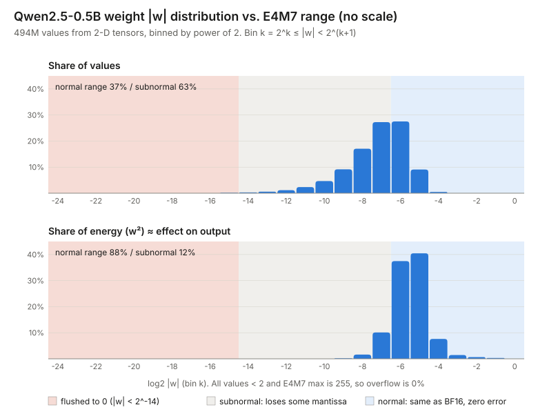
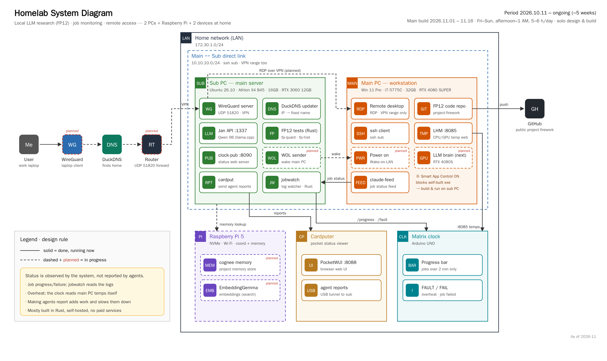

# project-firework

**English** | [한국어](README.ko.md)

Tiny tweaks that light up llm.

This project tests **small floating-point formats for LLM weights**. The first goal is **FP12**: a 12-bit float that keeps model quality almost the same as BF16 (16-bit) while using 25% less memory. All code is written in Rust.

## How a 12-bit float is built

A float has three parts: **sign**, **exponent** (how big or small the number can be) and **mantissa** (how precise it is).
With 12 bits, we choose how to split them. For example:

| Format | Sign | Exponent | Mantissa | Note |
|---|---|---|---|---|
| BF16 (original) | 1 | 8 | 7 | what the model is stored in |
| **E4M7** | 1 | 4 | 7 | same precision as BF16, smaller range |
| E5M6 | 1 | 5 | 6 | more range, 1 bit less precision |
| E6M5 | 1 | 6 | 5 | even more range, less precision |

## Workflow

Each experiment follows the same steps. Experiments run on the sub PC (see [Homelab](#homelab)).

1. **Convert**: `fp-quant` reads the model's weights (`.safetensors`) and rounds every value to the chosen format (e.g. E4M7). The file stays in BF16, so the result can go straight into llama.cpp.
2. **Measure quality**: `scripts/ppl.sh` converts each file to GGUF and runs `llama-perplexity` on wikitext-2. Lower perplexity (PPL) = better. Compare to the original model.
3. **Find out why**: `fp-hist` counts where the weight values fall (which exponent range) and how many get pushed into the small "subnormal" range or lost.
4. **Write it down**: results and charts go into a report (below).

Long runs write a log to `~/jobs/`. A monitor program reads the log and shows progress on a desk clock, so nobody has to check by hand.

```
model.safetensors ──fp-quant──▶ rounded weights ──llama.cpp──▶ PPL score
        │
        └──fp-hist──▶ value distribution ──▶ "why" chart
```

## Report #1: E4M7 is almost lossless (2026-11-14 ~ 15)

**Setup**: Qwen2.5-0.5B (BF16), wikitext-2 (584 chunks), llama.cpp `llama-perplexity`, RTX 3060.

| Format | Bits | PPL | vs BF16 |
|---|---|---|---|
| BF16 (original) | 16 | 13.9040 | – |
| **E4M7** | 12 | **13.9040** | **+0.00%** |
| E5M6 | 12 | 13.9104 | +0.05% |
| E6M5 | 12 | 13.9172 | +0.09% |
| Q8_0 (llama.cpp) | 8.5 | 13.9372 | +0.24% |
| Q6_K (llama.cpp) | 6.56 | 13.9656 | +0.44% |
| FP8 E4M3 (scaled) | 8 | 14.1225 | +1.57% |
| Q4_K_M (llama.cpp) | ~4.8 | 14.2648 | +2.59% |
| E5M2 (scaled) | 8 | 14.7325 | +5.96% |

**First observation**: compared to BF16, the information in the weights is not damaged; the model just got lighter. But this was only a number, not yet shown visually, so it needed checking.

**Check (fp-hist, 494M weight values)**:



- Every weight is smaller than 2, so E4M7's range never overflows.
- 63% of values are very small (below 2^-6) and become subnormal in E4M7, but they hold only 12% of the "energy" (w²).
- BF16 already has 7 mantissa bits, so the other values stay **bit-for-bit the same** in E4M7.
- E5M6 has more range but loses 1 mantissa bit on **every** value. That is why E4M7 wins.

**Limits**: one small model (0.5B) only. Q8_0 is still smaller on disk; FP12's plus is near-lossless quality with no calibration data.

**Next**: per-tensor scale with E4M7 / E3M8, a bigger model, and real 12-bit storage (pack 2 values in 3 bytes) with a GPU kernel.

## Run it

```
cargo build --release
./target/release/fp-quant model.safetensors out.safetensors --format e4m7
```

Formats: `fp12` (=e5m6), `e4m7`, `fp16`, `bf16`, `fp8` (=e4m3fn), `e5m2`, or any `e<E>m<M>`. Add `--scale` for a per-tensor scale.

## Homelab

The home setup this project is built and tested on.



- **Sub PC** (Ubuntu, RTX 3060): always-on server. Runs experiments, a local LLM API, the VPN server and the job monitor.
- **Main PC** (Windows 11, RTX 4080 SUPER): daily workstation. Windows blocks self-built programs, so builds run on the sub PC over ssh.
- **Matrix clock** (Arduino UNO): shows job progress, and warns when a PC overheats or a job fails.
- **Design rule**: status is *observed by the system* (logs, sensors), not reported by agents.

## License

MIT
